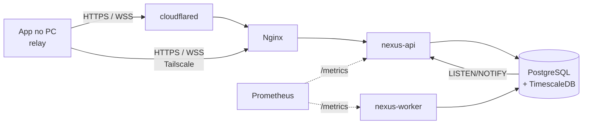

# Arquitetura

## Visão geral

O Nexus é um **monólito modular**. O código é dividido em crates com fronteiras claras, mas roda em apenas dois processos. Para a escala do projeto (um cliente, carga na casa de 0,1 req/s, 2 vCPU), separar em microserviços traria latência de rede, mais pontos de falha e mais coisa para operar, sem nenhum ganho. A justificativa completa está na [ADR 0002](adr/0002-monolito-modular.md).



## App desktop

O cliente é um app Tauri 2 ([ADR 0009](adr/0009-app-desktop-tauri-leptos.md)) com três partes:

- **núcleo em Rust**: cliente WebSocket do Nexus, execução de comandos no jogo e reconexão. Substitui o relay em Node;
- **janela do jogo**: o PokeIdle num webview, com o coletor injetado. O coletor é o único trecho em JavaScript do sistema, porque roda dentro da página do jogo;
- **interface** em Leptos (WebAssembly), também publicada como site pelo Nginx.

O crate `contrato` guarda os tipos que servidor e app trocam (DTOs da API e mensagens do WebSocket). Uma mudança incompatível de um lado quebra a compilação do outro, em vez de quebrar em produção.

## Processos

**nexus-api** atende todo o tráfego HTTP e WebSocket: bolsa, equipes, raros, ingestão de dados vindos do PC, fila de comandos e o motor de automação. O motor de combate e o otimizador também rodam aqui, já que são chamados por rotas.

**nexus-worker** não expõe rotas além de `/health` e `/metrics`. Ele roda as tarefas agendadas: ETL contínuo, cálculo de eficiência de hunts, scoring, rotinas de IA e geração do dossiê.

Os dois ficam separados para que um pico de ETL nunca dispute CPU com uma requisição de usuário. Cada container tem seu próprio limite de CPU no Compose.

## Crates

| Crate | Responsabilidade | Depende de |
|---|---|---|
| `nucleo` | Regras de negócio puras: indicadores da bolsa, motor de combate, otimizador, scoring. Sem I/O. | — |
| `persistencia` | Implementa os traits de repositório do `nucleo` usando sqlx/Postgres | `nucleo` |
| `nexus-api` | Rotas axum, middlewares, WebSocket, cache | `nucleo`, `persistencia` |
| `nexus-worker` | Scheduler e jobs | `nucleo`, `persistencia` |
| `contrato` | DTOs da API e mensagens do WebSocket, compartilhados com o app | — |
| `apps/desktop` | App Tauri + Leptos | `contrato` |

A regra é que as dependências só apontam "para dentro": o `nucleo` não sabe que o Postgres existe. Ele declara o que precisa por meio de traits:

```rust
pub trait RepoMercado {
    async fn vendas(&self, ticker: &TickerId) -> Result<Vec<Venda>, ErroRepo>;
}
```

Em produção quem implementa é o `PgRepoMercado`; nos testes, um repositório em memória. Com isso o motor de combate e os cálculos da bolsa são testados sem banco nenhum. É o padrão conhecido como arquitetura hexagonal (ports and adapters).

Rust não tem herança. O código usa `struct` + `impl` para objetos, `trait` para interfaces e composição para reaproveitamento. Mais em [ADR 0005](adr/0005-composicao-e-traits.md).

## Concorrência

O ponto delicado é misturar tokio (I/O assíncrono) e rayon (CPU) no mesmo processo com só 2 núcleos. Se o motor de combate ocupar as threads do tokio, a API para de responder até o cálculo terminar.

Como resolvemos:

1. **Pool do rayon com tamanho fixo**, configurável (`NEXUS_CPU_THREADS`, padrão 2), separado das threads do tokio.
2. **Cálculo pesado sai do runtime async.** O handler despacha o trabalho para o rayon e espera o resultado por um canal `oneshot`. Enquanto isso, o tokio continua atendendo outras requisições.
3. **Fila limitada.** Se já houver um cálculo de equipe rodando para a mesma chave, a requisição recebe `202 Accepted` com o progresso, como o sistema atual já faz. Requisições acima do limite recebem `503` com `Retry-After`.

## Cache

| Cache | Política | Origem |
|---|---|---|
| Resultado de combate | LRU, 400 entradas | herdado do legado |
| Alvos de coleta | TTL de 3 h | herdado do legado |
| Feedback da bolsa | LRU, 40 entradas, invalidado quando os tickers são recalculados | herdado do legado |
| Mercado da bolsa (snapshot) | remontado em segundo plano a cada 3 min e trocado de uma vez; quem lê nunca espera | substitui o cache com TTL do legado |
| Vendas da bolsa | em memória; cada ciclo lê só as últimas 12 h, recarga completa a cada 30 min | novo |
| Valor justo das ofertas | calculado para todas as ofertas ativas junto com o snapshot | substitui o cache parcial do legado |

Os caches ficam em memória no `nexus-api` (`moka`). Se o processo reiniciar, eles são reconstruídos sob demanda; nada depende deles para estar correto.

## Configuração

Toda configuração vem de variáveis de ambiente (com `.env` em desenvolvimento) e é validada na inicialização. Se faltar algo obrigatório, o processo não sobe e diz o que falta. Segredos vêm de Docker secrets, nunca do código. Veja [segurança](seguranca.md).

## Erros

- No domínio, cada módulo tem seu enum de erro com `thiserror`, e o chamador consegue tratar cada caso.
- Nos handlers, os erros viram respostas HTTP com corpo JSON padronizado: `{ "erro": { "codigo": "...", "mensagem": "..." } }`.
- `unwrap()` e `expect()` são proibidos fora de testes. O CI barra com `clippy::unwrap_used` e `clippy::expect_used`.
