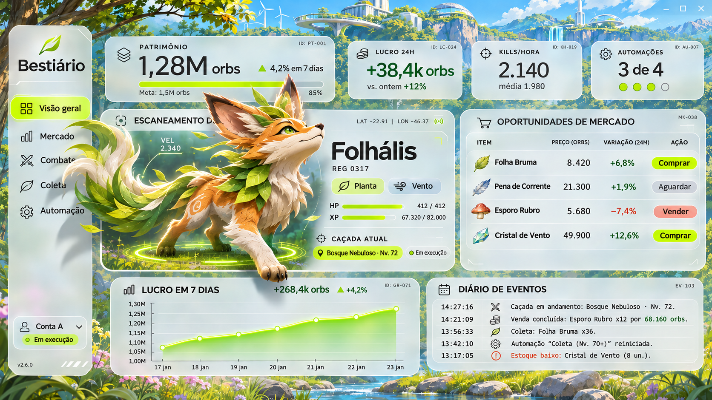

# Sistema visual

A identidade visual do app, consolidada a partir do mockup aprovado e da prévia do card de destaque. As telas estão em [telas.md](telas.md); aqui ficam os valores que todas usam.

*Referência aprovada da Visão geral. Os KPIs dela foram revistos depois pelas normas de BI (ver [telas.md](telas.md)); o que vale desta imagem é o visual.*

## Conceito

**Solarpunk claro, quase futurista.** Uma interface precisa e tecnológica flutuando sobre uma natureza ilustrada e viva. A força está no contraste entre o orgânico (a paisagem) e o digital (painéis de vidro, linhas finas, números de precisão). Otimista e luminoso; nada de estilo gamer, vintage ou neon pesado.

## Camadas da tela

De trás para a frente:

1. **Paisagem** do bioma da caçada da conta ativa, em tela cheia (ver *Biomas* em [telas.md](telas.md)).
2. **Névoa** clara sobre a paisagem, para dar leitura aos painéis.
3. **Painéis** de vidro fosco.
4. **Conteúdo** dos painéis.
5. **Criatura em destaque**, acima de tudo, saindo do card.

## Cores

| Token | Claro | Noturno | Uso |
|---|---|---|---|
| `--texto` | `#16181C` | `#EEF0F3` | texto principal |
| `--texto-2` | `#4C5560` | `#B4BCC6` | texto secundário |
| `--texto-3` | `#7A838D` | `#8A939E` | rótulos, eixos |
| `--vidro` | `rgba(255,255,255,.75)` | `rgba(14,17,22,.70)` | fundo dos painéis |
| `--vidro-borda` | `rgba(255,255,255,.75)` | `rgba(255,255,255,.10)` | borda de 1px dos painéis |
| `--trilho` | `rgba(22,24,28,.10)` | `rgba(255,255,255,.10)` | trilhos de barras, divisórias |
| `--neon` | `#C8FF2E` | `#C8FF2E` | **único acento**: item ativo, "em execução", linha principal de gráfico, ação principal |
| `--sobre-neon` | `#16181C` | `#16181C` | texto sobre o neon |
| `--melhora` | `#1F9D6B` | `#3DDC97` | variação positiva |
| `--piora` | `#E5533D` | `#FF6B57` | variação negativa, alertas |

Regras:

- O neon é usado com moderação. Se mais de 4 ou 5 elementos da tela estão em verde-limão, há neon demais.
- Melhora e piora nunca aparecem sem ▲ ou ▼, e status nunca sem ícone e texto.
- As cores de gráfico (categorias, escalas, divergentes) seguem a paleta validada pelo método de visualização do projeto, com passos próprios para o tema noturno, nunca uma inversão do tema claro.

## Tipografia

| Papel | Família | Uso |
|---|---|---|
| Interface e títulos | sans geométrica moderna (Space Grotesk nos títulos e números grandes; Inter no texto) | tudo |
| Dados técnicos | mono (JetBrains Mono) | horários, IDs, coordenadas, valores em tabela |

- Números grandes de KPI em traço fino (peso 300), sem `tabular-nums` (fica estranho em números isolados grandes).
- Números em colunas e tabelas sempre com `tabular-nums`.
- Rótulos pequenos em caixa alta com espaçamento de letras (`letter-spacing: .12em`).
- Nenhuma fonte serifada.

## Painéis

- Vidro fosco: fundo `--vidro` com `backdrop-filter: blur(22px)`.
- Cantos de **20 px**; elementos internos (pílulas, botões) totalmente arredondados.
- Borda de 1 px `--vidro-borda`.
- Sombra difusa e longa, de baixa opacidade.
- Marcações técnicas discretas nos cantos (ID do painel, coordenadas), em mono e `--texto-3`.
- Espaçamento em múltiplos de 8 px; entre painéis, espaço suficiente para a paisagem aparecer.

## Criatura em destaque (2.5D)

Aplicado pelo app sobre a imagem de fundo transparente (render 3D do HOME por padrão; ver *Imagens das criaturas* em [telas.md](telas.md)):

| Efeito | Detalhe |
|---|---|
| Saindo do card | a imagem fica numa camada acima do painel e ultrapassa a borda (cauda, orelhas, cabeça) |
| Anel holográfico | elipse em `--neon` no chão, com brilho suave, dentro do card |
| Sombra projetada | sombra difusa da criatura sobre o vidro |
| Luz de contorno | brilho fino na borda da criatura: verde-limão de dia, azulado à noite |
| Luz direcional | gradiente de cima à esquerda aplicado **só nos pixels da criatura** (a própria imagem é a máscara), em modo *screen* |
| Reflexo do anel | gradiente verde-limão de baixo para cima, também mascarado pela imagem |
| Aura | halo de luz suave e desfocado atrás da criatura |
| Cor | saturação +30%, contraste +10%, brilho +6% |
| Movimento | "respiração" lenta (4,5 s) e parallax leve com o mouse |
| Faíscas | poucas estrelas de 4 pontas em `--neon`, piscando |

Tudo isso desliga no **modo desempenho** e respeita `prefers-reduced-motion`.

## Tema noturno

- Mesma paisagem, mesma composição, à noite: céu estrelado, lua refletida na água, flora bioluminescente em verde-limão e ciano, vagalumes discretos, janelas acesas.
- Painéis em vidro fumê (`--vidro` noturno) e texto claro.
- O neon é o mesmo; ganha um brilho levíssimo, coerente com a flora bioluminescente.
- Na criatura, luz de contorno azulada (luar) e reflexo do anel mais forte.
- Pode seguir o horário local ou ser fixado em Configurações › Aparência.

## O que nunca fazer

- Neon em bordas, brilhos em todos os cartões, aurora, partículas por toda a tela.
- Cartões com cores de borda diferentes entre si.
- Efeitos de profundidade, sombra ou brilho **dentro** de gráficos, KPIs e tabelas.
- Ilustração decorativa competindo com dados.
- Mais de uma cor de acento.
